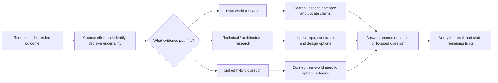

# Reasoning Workflow

A practical workflow for research, decisions, and reliable execution.

[English](README.md) · [简体中文](README.zh-CN.md)

[Open the workflow](skills/reasoning-workflow/SKILL.md) · [Download the complete package](dist/reasoning-workflow-3.1.0.zip) · [Technical architecture](skills/reasoning-workflow/docs/TECHNICAL_ARCHITECTURE.md) · [技术架构报告](skills/reasoning-workflow/docs/TECHNICAL_ARCHITECTURE.zh-CN.md)

## What this is

Reasoning Workflow is a set of instructions and optional tools that helps an AI agent work out what a question really depends on, choose a proportionate research method, and check whether its answer or deliverable is supported. Deep Research is a central use: the workflow follows the structure of the problem instead of matching a few words and collecting pages that repeat them.

It can help with real-world questions, research before a technical build, decisions, artifacts, and work that has to survive interruptions. It is not a model, search engine, permission system, or guarantee that an agent will follow every instruction. The host supplies activation, tools, source access, permissions, and any execution or persistence guarantees.

## How it works

The model starts with the requested outcome and the evidence or action that could change it. It loads only the guidance relevant to that task, follows the useful route, then checks the result against the original need. A simple question can be answered directly; a complex investigation can use deeper methods and more persistent state.

The host-selected model remains the default; the workflow infers a proportionate depth from the task, and an explicit user depth request takes precedence. The scale runs from Light through Standard, Deep and Max to Ultra. Depth changes effort—not model identity, autonomy, permissions, required answer length, or a fixed number of sources or agents. Ultra is for challenging the framing, following important dependencies, exploring genuinely different evidence routes, and checking decisive claims; it can still conclude that the simplest answer is enough.

## Two research paths

### Real-world and causal questions

First identify what kind of claim matters: what is happening, how common it is, what caused a change, how a mechanism might work, what may happen next, or what should be done. Those questions need different evidence.

For a causal question, the proposed chain is a map of hypotheses, not a finding. The workflow selects one link that could change the conclusion, searches for observations that distinguish the leading explanation from alternatives, reads the underlying source, and updates the claim. It may look separately for effects, mechanisms and timing, confounding or selection, and boundary or null results—but only when those routes could alter the answer. Terms, measures and source references learned from one useful paper can shape the next search. A search result, plausible mechanism, or repeated citation is not proof of the whole chain.

For example, to study whether after-school tutoring improves mathematics achievement, an agent might separate the effect estimate from the proposed attendance-and-feedback mechanism, then check prior achievement and family resources as competing explanations. It should verify each study’s population, comparison group, outcome, design and follow-up instead of treating every result for “tutoring” as interchangeable.

See [Retrieval and observation](skills/reasoning-workflow/references/retrieval-and-observation.md) for the search method and worked example, and [Research modes and methods](skills/reasoning-workflow/references/research-modes-and-methods.md) for evidence matching, survey/interview limits, and architecture research.

### Technical research before a build

Before recommending an architecture, inspect the actual repository and constraints: interfaces, tests, dependencies, runtime, and documented requirements. Translate the goals that matter into concrete scenarios—what should happen, under which conditions, and how success would be judged. Compare only plausible designs against those scenarios, including material trade-offs, risks, and assumptions that could reverse the recommendation.

When a small reversible prototype or benchmark can settle an important uncertainty, prefer that evidence over another layer of speculation. A concise decision record is useful for a durable or costly-to-reverse choice; routine reversible choices do not need one. Research recommends a direction; it does not authorize implementation.

If a question links user need and technical feasibility, keep the evidence chains connected but distinct: evidence that people need an outcome does not prove a proposed design can deliver it, and technical feasibility does not prove the outcome matters.

## Ask only when the user is the resolver

A missing detail is not automatically a reason to interrupt. The clarification gate checks the relevant conversation, project materials, current tools, external facts, and derivable details first. It asks only when the remaining uncertainty belongs to the user, could materially change the answer or decision, and cannot be handled honestly with a conditional result or reversible assumption. It asks for the smallest useful input and continues independent work where possible.

A question about priorities is not permission to send, spend, publish, delete, or otherwise act. The workflow keeps that boundary explicit.

## Automatic routing and direct invocation

The Portable entry is designed to perform a quiet, lightweight triage whenever it is available as the host’s default entry. It chooses the least sufficient depth and loads only relevant guidance; it does not run a full research process for every small request.

You can also say: “调用我的 workflow skills”. That selects the workflow for the current request; it does not automatically select Ultra, unlock tools, or grant additional permissions. The phrase in quoted text or source material is not an invocation.

Automatic activation is a host responsibility. A Skill file cannot force a host to load it. If every request must pass through the workflow, configure a trusted always-on instruction or front router, or keep the Skill active as the host’s default entry, then test that behavior on the actual host. Native skill matching may be best-effort. The included routing scripts choose depth and references from a task profile; they do not inspect every raw message or activate the Skill by themselves.

## Install and use

Choose one edition:

- **Portable** (`skills/reasoning-workflow/`) is the complete workflow: entry point, on-demand references, routing index, schemas, optional Python helpers, and tests. Use it when you want one governing entry and the full set of methods.
- **Modular** (`modular/`) splits the workflow into six focused instruction-only Skills for hosts that already route among Skills. It does not include the Portable Python runtime helpers or its cross-family state layer. See the [Modular guide](modular/README.md).

To install Portable, clone this repository or download the complete package above. Place the full `reasoning-workflow` directory in the Skill location recognized by your host (for example, `.agents/skills/reasoning-workflow/` for Codex or `.claude/skills/reasoning-workflow/` for Claude Code), then enable or select it as the host requires. Start from `SKILL.md`; follow its relative links only as needed. Do not copy only the entry file: its references and optional resources live beside it.

For a shell-based setup, the repository’s optional helper dependencies are listed in [`requirements.txt`](skills/reasoning-workflow/scripts/requirements.txt). Python helpers prepare or validate task records; they do not run a model, activate a Skill, or execute real-world actions.

Host-specific locations and fallback approaches are described in [Host and agent profiles](skills/reasoning-workflow/references/harness-profiles.md). Product features, plans, regions, workspace controls, connectors, and tool permissions differ. A feature advertised in product documentation is not proof that it is enabled in a particular account or session. Report an online research mode or connector as used only when the current run confirms it. If unavailable, use an appropriate supported fallback and say what could not be done.

## What the checks mean

The repository includes deterministic tests for routing helpers, schemas, package contents, links, and protocol cases. These checks can catch structural regressions and make expected behavior testable. They do not show that a model actually followed a protocol or improved the quality of its research. That requires running the same tasks with and without the workflow under comparable models, host, tools, and budgets, then assessing answers and observable evidence-gathering behavior.

Likewise, a valid plan, worker report, or checkpoint is not proof that an external effect happened. A trusted host must supply actual tool results, authorization checks, durable state, and enforcement where required.

## Repository map

- [`skills/reasoning-workflow/`](skills/reasoning-workflow/): canonical Portable workflow, methods, schemas, helpers, and tests.
- [`modular/`](modular/): focused Skills for host-native routing.
- [`tests/`](tests/): repository-level contract tests.
- [`dist/`](dist/): packaged workflow archives and checksums.
- [Technical architecture report (English)](skills/reasoning-workflow/docs/TECHNICAL_ARCHITECTURE.md) · [技术架构报告（简体中文）](skills/reasoning-workflow/docs/TECHNICAL_ARCHITECTURE.zh-CN.md)
- [Contributing](CONTRIBUTING.md) · [Privacy](PRIVACY.md) · [Terms](TERMS.md) · [MIT License](LICENSE)

Created and maintained by [折鸢 / zy839971925-zyy](https://github.com/zy839971925-zyy).
