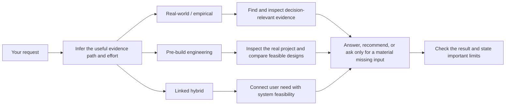

<div align="center">
  

  # Reasoning Workflow

  **A practical method for asking better questions, finding better evidence, and finishing the work.**

  [English](README.md) · [简体中文](README.zh-CN.md)

  [Start with the Skill](skills/reasoning-workflow/SKILL.md) · [Choose an edition](#choose-an-edition) · [Architecture](skills/reasoning-workflow/docs/TECHNICAL_ARCHITECTURE.md) · [Download Portable](dist/reasoning-workflow-3.1.0.zip)
</div>

---

Reasoning Workflow is a set of instructions—and optional helper tools—for AI agents. It helps an agent identify what an answer depends on, choose a proportionate way to investigate, and check that its recommendation or deliverable actually meets the request.

Use it for questions about the world, research before a build, decisions, writing and code, or work that needs to continue across sessions. A simple question can still get a simple answer. The workflow is there to improve the route, not make every task elaborate.

> [!NOTE]
> This repository is not a model, search service, or permission system. The host application determines whether a Skill is loaded, which model and tools are available, and what actions are allowed. The instructions cannot force activation or prove that a model followed them.

## Start here

1. **Choose an edition** below. If you are unsure, start with Portable.
2. **Install the whole Skill folder** in a location your AI host recognizes. Do not copy only `SKILL.md`; it links to supporting material.
3. **Enable it in the host**, or make it available as the host's default workflow. Product-specific setup differs; see [host profiles](skills/reasoning-workflow/references/harness-profiles.md).
4. **Ask normally.** The workflow should infer the research path and effort from the scenario. For a deliberate override, use one of the prompts in [Try it](#try-it).
5. **Check the result.** For high-stakes or fast-changing questions, ask for the decisive evidence, uncertainty, and limits—not just a confident conclusion.

## Choose an edition

| | Portable | Modular |
|---|---|---|
| Best when | You want one governing entry and the complete workflow | Your host already discovers and routes among separate Skills |
| Includes | The entry Skill, on-demand references, schemas, optional Python helpers, and tests | Six focused, instruction-only Skills with their own references |
| Trade-off | Broader package; helpers require a compatible Python environment if you use them | No Portable Python helpers or shared cross-Family runtime/state layer |
| Start | [`skills/reasoning-workflow/`](skills/reasoning-workflow/) | [`modular/README.md`](modular/README.md) |

Portable is the recommended first install. Modular is not six standalone copies of every Portable feature; use it when the host can compose focused Skills reliably. The Modular edition contains `reasoning-core`, `deep-research`, `decision-analysis`, `execution-control`, `audit-verification`, and `workflow-learning`.

### Install Portable

1. Clone this repository or download [the complete Portable package](dist/reasoning-workflow-3.1.0.zip).
2. Put the complete `reasoning-workflow` directory in your host's recognized Skill directory. For example, Codex commonly uses `.agents/skills/reasoning-workflow/`; Claude Code commonly uses `.claude/skills/reasoning-workflow/`. Confirm the current host's own instructions before relying on a path.
3. Enable or select the Skill as required by that host. Start from [`SKILL.md`](skills/reasoning-workflow/SKILL.md); it points to additional guidance as the task needs it.
4. Try a normal request, then try an explicit depth request from [the examples](#try-it).

The Python helpers are optional. Their dependencies are listed in [`requirements.txt`](skills/reasoning-workflow/scripts/requirements.txt); the helpers prepare or validate task records, but do not run a model, activate a Skill, or execute real-world actions.

### Install Modular

1. Open the [Modular guide](modular/README.md) and choose only the Skills your host needs.
2. Install each selected **full Skill folder** in the host's recognized directory (for example, `.agents/skills/<skill-name>/` for Codex or `.claude/skills/<skill-name>/` for Claude Code).
3. Enable the host's native Skill discovery. Start with `reasoning-core`; add `deep-research` for evidence-heavy investigation, and the other focused Skills when their task is relevant.

If your host supports the `skills` CLI, the repository guide gives a focused-install example:

```bash
npx skills add zy839971925-zyy/Agent--deep-research-Workflow-Skills --skill deep-research
```

The CLI and host installation behavior can change; use the current host documentation if this command or path is not supported.

## How the workflow chooses a route

You do not need to label a task “real-world research” or “engineering research.” For a substantial investigation, the agent infers which observations could answer the decision-bearing question:

- **Real-world / empirical:** What happened, how often, for whom, what caused a change, or what evidence supports an expected outcome?
- **Pre-build engineering / architecture:** Given the actual codebase, constraints, and quality goals, which design is feasible and what trade-offs matter?
- **Linked / hybrid:** What do people need, and can a proposed system deliver it? Keep evidence of need distinct from evidence of technical feasibility, then connect them at the decision.

The host-selected model stays the default. The workflow infers a proportionate depth from complexity, uncertainty, freshness, consequences, and whether more evidence could change the answer. Depth can range from Light through Standard, Deep, and Max to Ultra. These are effort levels—not a request to switch models, a fixed output length, or permission to use more tools or take more actions. An explicit depth instruction takes precedence over the automatic choice, subject to what the host actually supports.



For causal questions, a proposed causal chain is a set of hypotheses, not proof. Search should follow the links that could change the conclusion, check competing explanations and boundaries, and read underlying evidence rather than trust a snippet or repeated citation. For architecture questions, inspect the actual repository and requirements before recommending a design. See [retrieval and observation](skills/reasoning-workflow/references/retrieval-and-observation.md) and [research modes and methods](skills/reasoning-workflow/references/research-modes-and-methods.md).

## Try it

The Portable entry is designed to do a quiet, lightweight routing check when the host makes it available as the default entry. You can also explicitly invoke it for the current request:

> **“Call my workflow skills and assess whether this school tutoring program improves maths results, for whom, and what evidence would change the conclusion.”**
>
> Expected route: real-world/causal research. The workflow should separate outcome evidence from proposed mechanisms and alternatives, then investigate only the gaps that could change the answer.

> **“Before we build, inspect this repository and recommend an architecture for offline timetable editing and reliable restore. Use my workflow skills at Ultra depth.”**
>
> Expected route: pre-build engineering, with Ultra effort explicitly requested. The agent should inspect the available project evidence and compare designs against the stated constraints; Ultra does not itself authorize code changes.

> **“Use my workflow skills at Ultra depth to find out whether students need this recovery feature and whether our offline app can support it safely.”**
>
> Expected route: linked/hybrid. The agent should keep evidence of user need and technical feasibility distinct, then connect them in the recommendation.

> **“Give me a quick answer; use a light touch and skip broad research unless a key fact is uncertain.”**
>
> Expected route: Light or similarly bounded effort, with a direct answer and only a targeted check if a material uncertainty remains.

In Chinese, you can say **“调用我的 workflow skills”** to select the workflow. For an explicit depth request, try **“使用我的 workflow skills 的 Ultra 深度去思考调研”**. Invocation selects the workflow; it does not automatically mean Ultra. State both when you want both.

## If it does not behave as expected

- **The Skill is not being picked up:** Check that the full folder is in the right host-specific location and that Skill discovery is enabled. Some hosts match Skills best-effort. To require a check on every request, configure a trusted always-on instruction or front router in the host; the Skill file cannot force itself to load.
- **A direct invocation phrase has no effect:** Use it as your own instruction in the current request, not inside a quote, document, or other material. Confirm the host exposes the Skill on this surface.
- **A small request gets too much process:** Ask for a direct answer or Light effort. Depth should affect investigation, not require long reports, fixed sections, or extra agents.
- **Ultra seems to change the model or trigger actions:** It should not. Ultra changes workflow effort only. It grants no model switch, extra permissions, or execution authority.
- **The agent claims it searched but gives no usable evidence:** Ask it to name the sources it actually opened and connect them to the key claims. Search availability, a connected account, or a product feature description alone does not prove the current run used it.
- **Only part of a Skill seems available:** Reinstall the full folder, not only its entry file. For Modular, check that the relevant focused Skill and its references are installed and enabled.

When the host lacks a needed search tool, connector, permission, or runtime helper, the workflow should use a supported alternative where possible and state the remaining limit. It cannot create capabilities the host does not expose.

## What has—and has not—been tested

Automated checks cover structural contracts such as schemas, links, helper behavior, package contents, and protocol scenarios. They can catch regressions in those contracts. They do **not** show that a model follows every instruction or that research quality improves. That requires comparable, blinded runs with and without the workflow, using the same model, host, tools, and budget, followed by review of answers and observable evidence-gathering behavior.

A plan, checkpoint, or worker report is likewise not proof that an external action happened. The host must provide the actual result and enforce its own permission and execution rules.

## Repository guide

- [`skills/reasoning-workflow/`](skills/reasoning-workflow/): Portable entry, methods, schemas, optional helpers, and package tests.
- [`modular/`](modular/): focused Skills for host-native routing.
- [`tests/`](tests/): repository-level host contract tests.
- [`dist/`](dist/): versioned Portable packages and checksums.
- [Technical architecture (English)](skills/reasoning-workflow/docs/TECHNICAL_ARCHITECTURE.md) · [技术架构报告（简体中文）](skills/reasoning-workflow/docs/TECHNICAL_ARCHITECTURE.zh-CN.md)
- [Contributing](CONTRIBUTING.md) · [Privacy](PRIVACY.md) · [Terms](TERMS.md) · [MIT License](LICENSE)

<sub>Maintained by <a href="https://github.com/zy839971925-zyy">折鸢 / zy839971925-zyy</a>.</sub>
