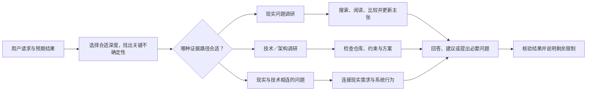

# Reasoning Workflow

面向调研、决策与可靠执行的实用工作流。

[English](README.md) · [简体中文](README.zh-CN.md)

[查看工作流入口](skills/reasoning-workflow/SKILL.md) · [下载完整包](dist/reasoning-workflow-3.1.0.zip) · [技术架构报告](skills/reasoning-workflow/docs/TECHNICAL_ARCHITECTURE.zh-CN.md) · [English architecture report](skills/reasoning-workflow/docs/TECHNICAL_ARCHITECTURE.md)

## 这是一个什么项目

Reasoning Workflow 是一套供 AI Agent 使用的指引与可选工具，帮助模型弄清问题真正取决于什么、选择合适且不过度的调研方法，并检查回答或交付是否有依据。深度调研是它的重要用途：沿着问题结构找证据，而不是只匹配几个关键词，再收集一堆重复同一说法的网页。

它适用于现实问题调研、开发前的技术研究、决策、文件与代码产出，以及需要跨中断持续推进的工作。它不是模型、搜索引擎、权限系统，也不保证 Agent 一定遵循每条指引。Skill 的激活、工具、资料访问、权限，以及执行或持久化保障，都由宿主提供。

## 工作方式

模型先确认要达成的结果，以及哪些证据或行动可能改变答案；再按当前任务加载必要的方法，推进有用的路径，最后对照原始需求核验结果。简单问题可以直接回答；复杂调研则可以使用更深入的方法和持久状态。

默认保留宿主当前选择的模型，由工作流根据任务自动判断合适的深度；用户明确指定深度时以其要求为准。工作深度从 Light、Standard、Deep、Max 到 Ultra。深度影响投入程度，不会改变模型身份、自主权或权限，也不要求固定答案长度、来源数或 Agent 数量。Ultra 会更认真地检查问题框架、关键依赖、不同证据路径和决定性主张；但如果直接回答已经足够，结论仍可以很简单。

## 两种调研路径

### 现实问题与因果问题

先判断需要回答哪一类主张：发生了什么、规模多大、什么导致变化、某种机制如何起作用、接下来可能怎样，或应该怎么做。它们需要的证据并不相同。

面对因果问题时，因果链只是待检验的假设图，不是结论。工作流会挑出一个可能改变答案的因果环节，寻找能区分主要解释与替代解释的观察，阅读原始材料，再更新对应主张。视问题需要，可以分别查效应、机制与时间顺序、混杂或选择偏差，以及适用边界或无效结果；只有这些路径可能影响结论时才做。读到的术语、测量方法和文献引用，可以帮助设计下一轮搜索。搜索结果、听起来合理的机制或反复出现的引文，都不能单独证明整条因果链。

例如，研究课后辅导是否提升数学成绩时，可以把效果估计与“出勤和反馈”机制分开，再核查先前成绩、家庭资源等竞争解释。比较研究时要看清研究对象、对照组、结果指标、设计和追踪时长，不能把所有标题含“辅导”的结果当成同一种证据。

具体搜索方法和示例见[检索与观察](skills/reasoning-workflow/references/retrieval-and-observation.md)；证据匹配、访谈／问卷边界和架构研究见[研究模式与方法](skills/reasoning-workflow/references/research-modes-and-methods.md)。

### 开发前的技术与架构调研

在建议架构前，先检查真实仓库和约束：现有接口、测试、依赖、运行环境和已写明的需求。把重要目标转成具体场景——什么条件下要发生什么，怎样判断成功；再用这些场景比较可行方案，说明关键取舍、风险，以及哪些假设改变时建议也会改变。

如果一个小型、可逆的原型或基准测试能回答重要不确定性，优先用它验证，而不是继续堆推测。对长期影响大、难以撤回的选择，可以留下简短决策记录；普通且容易调整的选择不必为此建档。调研可以推荐方向，但不等于获得实施授权。

如果问题同时涉及用户需求和技术可行性，就把两条证据链连起来但不要混为一谈：用户需要某个结果，不代表指定架构能实现它；技术上做得到，也不代表这个结果值得做。

## 只有用户本人能解决时才提问

信息缺失不代表要马上打断用户。澄清闸门会先检查相关对话、项目材料、当前工具、外部事实和可推导的信息；只有剩下的不确定性确实属于用户，可能实质改变答案或选择，而且不能用条件式结论或可逆假设诚实处理时，才提出最小必要问题。有独立工作可做时，会继续推进。

询问用户的优先级，不等于获得发送、付款、发布、删除或其他外部行动的许可；工作流会明确保留这条边界。

## 自动路由与主动调用

Portable 入口的设计目标是：当宿主把它作为默认入口提供时，对每条直接请求静默做轻量分流，选最合适的工作深度，并只加载相关方法；不会因为每个小问题都启动完整调研。

你也可以直接说：“调用我的 workflow skills”。这会为当前请求选择该工作流，但不会自动切到 Ultra、开放工具或增加权限。引用文字或资料里出现这句话，不算用户主动调用。

自动激活由宿主负责。Skill 文件本身不能强迫宿主加载自己。若希望每条请求都经过工作流，需要把它设为宿主默认入口，或配置可信的 always-on 指令／前置路由，并在实际宿主上验证。原生 Skill 匹配可能只是尽力而为。仓库里的路由脚本只能依据任务 profile 选择深度和参考资料；它不会自行读取每条自然语言消息，也不会独立激活 Skill。

## 安装与使用

有两个版本可选：

- **Portable**（`skills/reasoning-workflow/`）是完整工作流，包含入口、按需参考资料、路由索引、Schema、可选 Python 工具和测试。适合希望使用统一入口和完整方法体系的情况。
- **Modular**（`modular/`）把工作流拆成六个面向特定任务的指令型 Skill，适合宿主已经能做好 Skill 路由时使用；它不包含 Portable 的 Python 运行辅助工具和跨 Family 状态层。详见 [Modular 指南](modular/README.md)。

安装 Portable 时，克隆仓库或下载上面的完整压缩包；把整个 `reasoning-workflow` 文件夹放进宿主识别的 Skill 目录（例如 Codex 的 `.agents/skills/reasoning-workflow/`，或 Claude Code 的 `.claude/skills/reasoning-workflow/`），再按宿主要求启用或选中。让模型从 `SKILL.md` 开始，仅在任务需要时沿相对链接读取参考资料。不要只复制入口文件：它依赖同目录中的方法文档和可选资源。

可选 Python 工具依赖列在 [`requirements.txt`](skills/reasoning-workflow/scripts/requirements.txt)。这些工具可以准备或校验任务记录，但不会运行模型、激活 Skill 或执行现实世界操作。

宿主安装位置与替代方案见[宿主与 Agent 配置](skills/reasoning-workflow/references/harness-profiles.md)。不同产品的功能、套餐、地区、工作区限制、连接器和工具权限并不相同。产品文档说某功能存在，不代表当前账号或会话已启用；只有本次运行确有证据时，才能说实际使用了某种在线调研模式或连接器。若功能不可用，应使用支持的替代路线，并说明还有什么没法完成。

## 测试能说明什么

仓库包含用于路由工具、Schema、包内容、链接和协议场景的确定性测试。这些检查可以发现结构性回归，也能把预期行为写成可测试的要求；但它们不能证明模型实际照做，也不能证明调研质量提高。要评估效果，需要在模型、宿主、工具和预算可比的条件下，对同一组任务进行有／无工作流的测试，再评阅答案和可观察的证据收集过程。

同样，有效的计划、子代理报告或检查点并不能证明外部动作真的发生。需要可信宿主提供真实工具回执、权限检查、持久化和必要的执行约束。

## 仓库导航

- [`skills/reasoning-workflow/`](skills/reasoning-workflow/)：Portable 主版本、方法文档、Schema、工具和测试。
- [`modular/`](modular/)：供宿主原生路由使用的分体 Skill。
- [`tests/`](tests/)：仓库级接口契约测试。
- [`dist/`](dist/)：打包文件及校验和。
- [技术架构报告（简体中文）](skills/reasoning-workflow/docs/TECHNICAL_ARCHITECTURE.zh-CN.md) · [English technical architecture report](skills/reasoning-workflow/docs/TECHNICAL_ARCHITECTURE.md)
- [贡献指南](CONTRIBUTING.md) · [隐私说明](PRIVACY.md) · [使用条款](TERMS.md) · [MIT License](LICENSE)

由[折鸢 / zy839971925-zyy](https://github.com/zy839971925-zyy)创建和维护。
