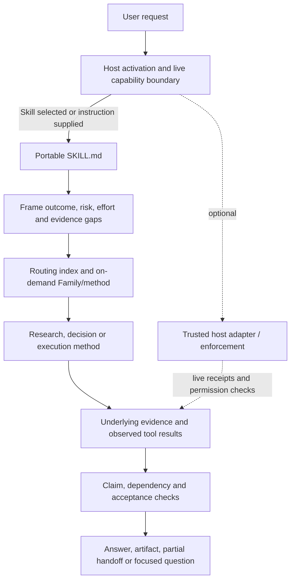
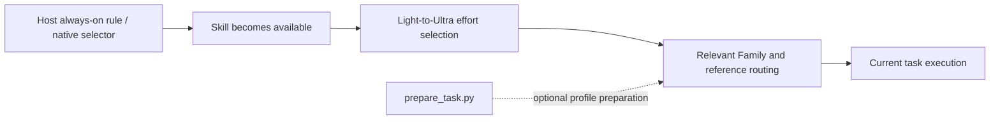
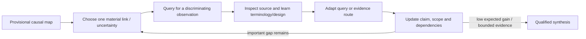

# Technical architecture and execution boundaries

**Design baseline:** Reasoning Workflow 3.0.0, merged into `main` on 2026-10-24. This report describes the repository design; it is not a claim that any host activated the Skill or that model behavior improved. The comparison baseline for the 3.0.0 work was 2.1.1 (`97efc58`); 2.2.0 was a local intermediate candidate.

[中文技术架构报告](TECHNICAL_ARCHITECTURE.zh-CN.md) · [English README](../../../README.md) · [中文 README](../../../README.zh-CN.md)

## 1. Architectural intent

Reasoning Workflow is a portable, model-facing method plus optional deterministic preparation and validation tools. It is not itself a model, a web-search engine, a permission system, a durable task service, or an external-action executor. The host supplies activation, model runtime, tools, identity, permissions, persistence, and any actual execution enforcement.

The architecture aims to keep four responsibilities distinct:

1. The host decides whether and how the Skill is activated and which tools are actually available.
2. The workflow chooses a proportionate research/execution method and the next useful step.
3. Evidence and runtime receipts establish what was actually read, executed, or completed.
4. Static checks and protocol scenarios validate repository artifacts and specify expected behavior; only a model-in-the-loop evaluation can measure whether a model follows the workflow.

The dotted adapter is optional and host-owned. Instructions can direct a model to request or use a tool; only an actual host integration can enforce the call, check live permission, record the effect, or guarantee persistence.

## 2. Skill activation and routing

### Activation is a host responsibility

Automatic invocation has two separate stages:

- **Activation:** an always-on host instruction, native skill discovery/selector, or trusted front router makes this Skill available for a turn. This stage cannot be guaranteed by a file inside a Skill that the host has not loaded.
- **Method routing:** once the Skill is present, its entry guidance classifies the task and loads only relevant methods/references. The optional `prepare_task.py` helper normalizes a supplied profile and prepares a route; it does not inspect arbitrary natural-language turns or activate a host Skill by itself.

A deployment that promises silent invocation on every user request must therefore configure and test the host-level activation rule. Best-effort native discovery is not an every-turn guarantee. Explicit wording such as “use/call my workflow skills” can be mapped to the same workflow entry; quoted or discussed wording is not itself an invocation. Host-specific instructions must preserve stronger platform rules and available-tool limits.

`routing-index.json` describes routeable Families, methods, triggers, references, and resource needs. The Lightweight path can answer simple questions without loading the research library. Deeper tiers increase effort only when ambiguity, stakes, dependencies, or expected answer gain justify it; they do not grant more authority or imply automatic delegation.

## 3. Portable and Modular editions

- **Portable** (`skills/reasoning-workflow/`) is the canonical package. It includes the root entry, routing index, Families, references, JSON schemas, optional Python helpers, fixtures, and tests. It is the complete choice when deterministic route preparation and cross-Family state matter.
- **Modular** (`modular/`) splits the six instruction-focused Families for hosts with their own skill discovery/routing. It mirrors selected references at their point of use. It does not reproduce Portable's Python router, schemas, runtime helper layer, or cross-Family state as an independent execution service.

The mirrored texts and relative links are checked as repository/package contracts. They are still guidance read by a model, not separately running agents.

## 4. Research and causal web retrieval

The research path begins with an information need, not a keyword quota. It distinguishes real-world/empirical questions, pre-build technical architecture questions, and linked hybrid questions. The evidence surface is chosen by where the uncertainty can be observed: user-provided material, the live repository/runtime, structured records, public sources, or an authorized experiment.

For causal questions, a proposed chain remains a set of hypotheses. The retrieval method selects one answer-changing edge and targets the evidence that can discriminate among explanations. It may search distinct roles—effect/comparison and design, mechanism and timing, confounding/selection/reverse causality, and boundary/null/adverse evidence—only when each can change the answer. A source's terms, measures, study design, population, cited work, or registry identifier can update the next query. The model then reads underlying material, checks the exact scope and design, updates which claim/link is supported, contradicted, or unresolved, and stops when another route has low expected answer gain.

Queries are retrieval moves, not evidence. Search snippets, ranking, phrase operators, one study, a plausible mediator, or a citation trail alone do not verify a causal chain. Prefer direct observation and primary material where appropriate; evaluate population, comparator, design assumptions, outcome and time scope. Citation chaining can discover a missing route but correlated papers are not independent confirmation. Report search scope and access limits proportionately; a failed or empty query does not establish absence.

The implementation is in [Retrieval and observation](../references/retrieval-and-observation.md), with a concrete tutoring example, search-method bibliography, and the protocol-only [V3-WS scenario](../evals/v3-functional-scenarios.md#v3-ws-causal-chain-web-search-beyond-keyword-matching). These sources inform the method; they do not prove that an LLM performs better with it.

## 5. Clarification and architecture decisions

The clarification gate separates four kinds of missing information: user intent/priority, existing project evidence, external facts, and safe routine details. Check only the available sources relevant to a missing dependency and capable of changing the answer. Ask only when the unresolved choice belongs to the user, changes the recommendation or required output, and cannot be handled with a clear conditional answer or reversible assumption. Continue independent work. A reply to a question does not grant permission for a separate external action.

For development-before-build research, inspect the real repository and constraints first. When a decision depends on quality attributes (for example privacy, offline use, recovery, latency, maintenance), express those as concrete scenarios and compare viable designs against them. Keep a concise architecture decision record for durable, costly-to-reverse choices; use a reversible prototype/benchmark only when it can discriminate a material engineering assumption. Research recommendations are not implementation authorization.

## 6. Long-running work, recovery, and delegation

The workflow uses task state, acceptance conditions, dependencies, checkpoints, artifacts, and delivery manifests when task duration or consequence warrants them. It does not prescribe one persistence backend. On resume, reconcile the root goal and latest user instruction with the current checkpoint, repository/workflow revision, live host/tools/permissions, relevant upstream sources, and actual artifacts. If a path is stale, relocate candidate files in the authorized workspace and compare their identity/version/content before choosing; unknown is not unchanged or absent. Recompute only results dependent on changed conditions.

A child report, planned command, or “complete” checkpoint does not establish the external result. A partial handoff retains open acceptance conditions. A canceled root is not reopened by a late worker result; cancellation also does not prove that an already submitted external side effect stopped. For an uncertain write, reconcile the destination before any retry. These are protocol requirements; if a host does not persist or enforce the relevant state, the capability remains a limitation rather than a guarantee.

## 7. Verification layers and what they establish

| Layer | Current candidate evidence | What it establishes | What it does not establish |
| --- | --- | --- | --- |
| Static / contract tests | 34 repository tests and 69 Portable regression tests have passed for the candidate after the latest recorded edits; final package run must match the delivered archive. | Schemas, deterministic helpers, fixtures, links, routing references, and package contracts meet their tested assertions. | Natural-language model compliance, better research answers, or real host integrations. |
| Functional scenario protocols | 21 cross-task cases and 17 V3 scenarios describe observable checks; they are marked protocol-only. | Testable expected actions, artifacts, handoffs, and failure conditions are specified. | That any model has executed or passed them. |
| Model-in-the-loop comparison | Not run. | Nothing yet. | No claim that model quality, search quality, adherence, cost, latency, or long-task success improved. |
| Host integration | Optional interfaces are documented; actual availability depends on deployment. | A trusted host may implement and test the described contracts. | This repository alone does not enforce global activation, permissions, external writes, payment, durable storage, or rollback. |

For a defensible effectiveness claim, run the same model, host, tools, task set, and budgets against the baseline and candidate; blind-score final answers and observable retrieval/clarification/recovery traces with separate metrics. Protocol and static test counts are not model-performance scores.

## 8. Repository map

- [`../SKILL.md`](../SKILL.md): model-facing entry and workflow contract.
- [`../routing-index.json`](../routing-index.json): routes, triggers, resource requirements, and references.
- [`../families/`](../families/): on-demand task Families.
- [`../references/`](../references/): detailed methods, including causal retrieval, clarification, host profiles, and recovery.
- [`../evals/`](../evals/): cross-task cases, V3 protocol scenarios, and fixtures.
- [`../scripts/`](../scripts/): optional deterministic preparation/build helpers.
- [`../tests/`](../tests/): static, schema, CLI, and package-contract tests.
- [`../../../modular/`](../../../modular/): focused instruction-only edition.
- [`../TEST_REPORT.md`](../TEST_REPORT.md), [`RELEASE_3.0.0.zh-CN.md`](RELEASE_3.0.0.zh-CN.md): recorded verification and release notes.

## References

- Software Engineering Institute, Carnegie Mellon University. [Architecture Tradeoff Analysis Method (ATAM)](https://www.sei.cmu.edu/library/architecture-tradeoff-analysis-method/). An architecture evaluation method; the workflow borrows a light scenario/trade-off framing, not a claim to perform a formal ATAM review.
- Bates, M. J. (1989). [The Design of Browsing and Berrypicking Techniques for the Online Search Interface](https://pages.gseis.ucla.edu/faculty/bates/articles/berrypicking.pdf). *Online Review*, 13(5), 407–424.
- Cochrane Handbook. [Chapter 4: Searching for and selecting studies](https://www.cochrane.org/authors/handbooks-and-manuals/handbook/current/chapter-04). Systematic-review search methods are not a mandatory quota for ordinary queries.
- Hernán, M. A. et al. (2024). [Causal Inference About the Effects of Interventions From Observational Studies in Medical Journals](https://jamanetwork.com/journals/jama/fullarticle/2818746). *JAMA*.
- Kahneman, D., & Klein, G. (2009). [Conditions for intuitive expertise: A failure to disagree](https://pubmed.ncbi.nlm.nih.gov/19739881/). *American Psychologist*, 64(6), 515–526.

For the broader methods bibliography and additional limitations, see [Research modes and methods](../references/research-modes-and-methods.md) and [Retrieval and observation](../references/retrieval-and-observation.md).
