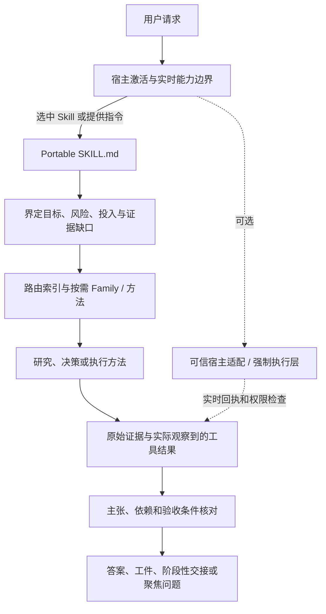

# 技术架构与执行边界

**候选：** Reasoning Workflow 3.0.0，本地审阅分支。本报告描述仓库设计，不代表任何宿主已实际激活 Skill，也不代表模型行为已经提升。本轮开始时核对的 GitHub `main` 比较基线是 2.1.1（`97efc58`）；2.2.0 是此前的本地中间候选。

[English technical architecture](TECHNICAL_ARCHITECTURE.md) · [中文 README](../../../README.zh-CN.md) · [English README](../../../README.md)

## 1. 架构目标

Reasoning Workflow 是一套可移植、面向模型的工作方法，配有可选的确定性任务准备与校验工具。它本身不是模型、联网搜索引擎、权限系统、持久化任务服务或外部行动执行器。技能激活、模型运行时、工具、身份、权限、状态保存和实际执行约束，都由宿主提供。

架构刻意区分四项职责：

1. 宿主决定本轮是否、如何激活 Skill，以及实际开放哪些工具。
2. Workflow 选择与任务相称的研究/执行方法和下一步。
3. 证据和运行回执说明实际读取、执行或完成了什么。
4. 静态检查和协议场景分别验证仓库工件、规定待测行为；只有模型参与的实测，才能衡量模型是否会遵循工作流。

虚线适配层是可选的、由宿主拥有。提示可以指导模型请求或使用工具；只有实际宿主集成才能强制工具调用、检查当前权限、记录效果或保证持久化。

## 2. Skill 激活与路由

自动调用有两个不同阶段：

- **激活：** 宿主的常驻指令、原生 Skill 发现/选择器或可信前置路由器，先让本 Skill 对当前轮可用。若宿主尚未加载 Skill，Skill 自己的文件无法保证被自动读到。
- **方法路由：** Skill 可用之后，入口规则判断任务并按需加载相关方法和参考。可选的 `prepare_task.py` 会规范化已提供的 profile 并准备路由；它不会自行检查任意自然语言请求，也不能替宿主激活 Skill。

因此，若部署承诺每次用户请求都静默调用，就必须在宿主层配置并测试激活规则。尽力而为的原生发现，不等于每轮保证。用户明确说“调用我的 workflow skills”时，可映射到同一入口；被引用或讨论的这句话本身不算调用。宿主专属指令还必须服从更高优先级的平台规则和当下工具边界。

`routing-index.json` 描述可路由的 Families、方法、触发条件、参考文档和资源需求。简单 Light 任务可不载入研究资料而直接回答。只有歧义、后果、依赖或预期答案收益足以支持更深投入时，才提升层级；提升层级不会增加权限，也不意味着必须委派。

## 3. Portable 与 Modular 版本

- **Portable**（`skills/reasoning-workflow/`）是规范包，含入口、路由索引、Families、参考、JSON Schema、可选 Python 工具、夹具与测试。需要确定性路由准备和跨 Family 状态时，应使用这一完整版本。
- **Modular**（`modular/`）将六个偏指令型 Family 拆分，面向已有 Skill 发现/路由能力的宿主。它会在各模块中镜像对应方法，但不独立包含 Portable 的 Python 路由器、Schema、运行时辅助层或跨 Family 状态服务。

仓库测试会检查镜像文本与相对链接的一致性。它们仍是由模型阅读的指导，不是各自运行的 Agent。

## 4. 研究方法与因果链联网检索

研究从信息需求开始，而不是从关键词配额开始。先区分现实/经验问题、开发前技术架构问题，以及彼此依赖的混合问题；再选最可能观察到关键不确定性的证据面：用户材料、当前仓库/运行环境、结构化记录、公开来源，或已获授权的实验。

面对因果问题，因果链先是待查假设，不是既成事实。检索时先挑一个会改变答案的因果边，再找能区分竞争解释的观察。只有当相应证据路线可能改变答案时，才分别查效应/对照与研究设计、机制与时间顺序、混杂/选择/反向因果，以及边界/无效/不利结果。来源里的术语、测量方法、研究设计、人群、引用或登记编号，可以成为下一轮查询的新线索。随后阅读原文，核对研究范围和设计，更新各条主张/关系为支持、冲突或未解决；当继续搜索的预期答案收益很低时停止。

查询本身不是证据。搜索摘要、排序、引号语法、一项研究、看似合理的中介，或单条引用链，都不能验证整条因果链。适当时优先直接观察与原始材料；核对研究对象、对照、设计假设、结果定义和时间范围。引用追踪能发现遗漏路径，但相互关联的论文不是独立佐证。按任务需要报告检索范围和访问限制；无结果不等于证据不存在。

具体方法见[检索与观察](../references/retrieval-and-observation.md)，其中有教学辅导案例、检索方法文献和协议型 [V3-WS 场景](../evals/v3-functional-scenarios.md#v3-ws-causal-chain-web-search-beyond-keyword-matching)。这些来源支持方法设计，不证明加入该方法后语言模型表现会提升。

## 5. 澄清与架构决策

澄清闸门区分四类缺失信息：用户意图/优先级、现有项目证据、外部事实和可安全推断的常规细节。只检查与具体缺口相关、且可能改变答案的可用来源。只有在缺失选择确属用户本人、会改变建议或交付要求、又无法用条件式回答或可逆假设处理时，才向用户提问；同时继续独立工作。用户回答某个问题，不会自动授权另一项外部行动。

开发前的架构研究先检查真实仓库和约束。若决策取决于质量属性（例如隐私、离线使用、恢复、延迟或维护），就把它们写成具体场景，再据此比较可行方案。对持久、难逆的决策，保留精简架构决策记录；只有当原型/基准能区分重要工程假设时，才建议做可逆试验。研究建议不等于获准实施。

## 6. 长期任务、恢复与委派

任务时长或后果足以支持时，工作流使用任务状态、验收条件、依赖、检查点、工件及交付清单，但不规定唯一的持久化后端。恢复时要把根目标和最新用户要求，与当前检查点、仓库/工作流版本、宿主/工具/权限、相关上游来源及实际工件重新对齐。路径失效时，在授权工作区重新定位候选文件，核对身份、版本和内容后再选；未知不等于没变或不存在。只重算依赖改变条件的结果。

子代理报告、计划执行的命令或标记为“完成”的检查点，都不能证明外部结果。阶段性交接必须保留未完成验收项。根任务取消后，迟到的工作者结果不能重新启动任务；取消也不能证明已经提交的外部副作用已停止。写入结果不确定时，重试前先检查目标状态。这些是协议要求；如果宿主没有保存或强制相关状态，必须把它说明为限制，而不能当成保证。

## 7. 验证层次与结论边界

| 层次 | 当前候选证据 | 能说明什么 | 不能说明什么 |
| --- | --- | --- | --- |
| 静态/契约测试 | 最新已记录版本通过 34 项仓库测试和 69 项 Portable 回归测试；最终发布数字须与交付压缩包对应。 | Schema、确定性辅助程序、夹具、链接、路由引用及包契约通过被测断言。 | 模型是否遵循自然语言、研究答案是否更好、真实宿主集成是否可用。 |
| 功能场景协议 | 21 个跨任务案例、17 个 V3 场景规定可观察检查，均标注为 protocol-only。 | 预期动作、工件、交接和失败条件已被明确写成可测项目。 | 任何模型已经运行或通过这些场景。 |
| 模型参与的对照 | 尚未运行。 | 暂无实测结论。 | 不能声称模型质量、搜索质量、遵循率、成本、延迟或长任务成功率已提升。 |
| 宿主集成 | 文档描述了可选接口；具体能力取决于部署。 | 可信宿主可以实现并测试所述契约。 | 仅凭仓库不能强制全局激活、权限、外部写入、支付、持久化或回滚。 |

要作出可信的效果判断，需在同一模型、宿主、工具和预算下，对基线版与候选版运行相同任务；盲评最终答案，并分别评估可观察的检索、澄清和恢复轨迹。协议和静态测试数量不是模型表现分数。

## 8. 仓库导航

- [`../SKILL.md`](../SKILL.md)：面向模型的入口与工作流契约。
- [`../routing-index.json`](../routing-index.json)：路由、触发条件、资源需求与参考。
- [`../families/`](../families/)：按需加载的任务 Family。
- [`../references/`](../references/)：详细方法，包括因果检索、澄清、宿主适配和恢复。
- [`../evals/`](../evals/)：跨任务案例、V3 协议场景及夹具。
- [`../scripts/`](../scripts/)：可选的确定性任务准备与打包工具。
- [`../tests/`](../tests/)：静态、Schema、CLI 和包契约测试。
- [`../../../modular/`](../../../modular/)：指令型模块版本。
- [`../TEST_REPORT.md`](../TEST_REPORT.md)、[`RELEASE_3.0.0.zh-CN.md`](RELEASE_3.0.0.zh-CN.md)：验证记录与发布说明。

## 参考资料

- Carnegie Mellon University 软件工程研究所（SEI）。[Architecture Tradeoff Analysis Method (ATAM)](https://www.sei.cmu.edu/library/architecture-tradeoff-analysis-method/)。这是架构评估方法；本工作流借鉴轻量的场景/取舍表达，不声称执行了正式 ATAM 评审。
- Bates, M. J. (1989). [The Design of Browsing and Berrypicking Techniques for the Online Search Interface](https://pages.gseis.ucla.edu/faculty/bates/articles/berrypicking.pdf). *Online Review*, 13(5), 407–424.
- Cochrane Handbook. [Chapter 4: Searching for and selecting studies](https://www.cochrane.org/authors/handbooks-and-manuals/handbook/current/chapter-04)。系统综述的检索方法不是日常问题的固定来源配额。
- Hernán, M. A. et al. (2024). [Causal Inference About the Effects of Interventions From Observational Studies in Medical Journals](https://jamanetwork.com/journals/jama/fullarticle/2818746). *JAMA*.
- Kahneman, D., & Klein, G. (2009). [Conditions for intuitive expertise: A failure to disagree](https://pubmed.ncbi.nlm.nih.gov/19739881/). *American Psychologist*, 64(6), 515–526.

更完整的方法文献和限制见[研究模式与方法](../references/research-modes-and-methods.md)及[检索与观察](../references/retrieval-and-observation.md)。
